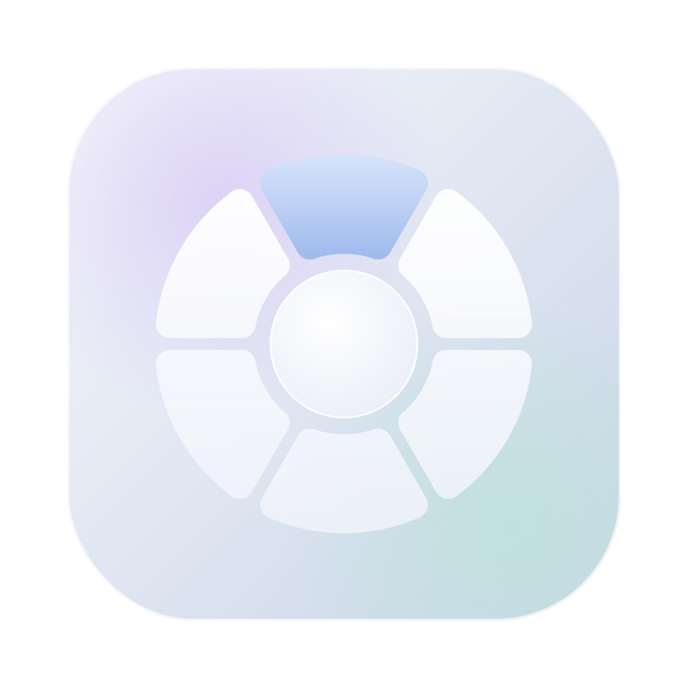

<p align="center"></p>

<h1 align="center">Facet</h1>
<p align="center">Dosyayı sürükle, bir tuşa dokun, bırak. Hafif, tamamen çevrimdışı bir Mac dosya aracı.</p>

---

Facet, Tangerine'in sürükle-bırak çarkı fikrinden yola çıkıp sıfırdan yazıldı. Ses, altyazı, slayt ve arşiv kategorileri yok. Dropover benzeri bir **Float** rafı var. Görünüm macOS'un Liquid Glass stilinde ve sistem vurgu rengini kullanıyor. Hiçbir dosya internete gönderilmiyor, hesap ya da analitik yok.

## Nasıl kullanılır

Finder'da (ya da herhangi bir uygulamada) bir dosyayı sürüklemeye başla ve bir tuşa **dokun**:

| Tuş | Çark | İçerik |
|---|---|---|
| **⇧ Shift** | Dönüştür | Hedef formatlar (PNG, MP4, DOCX…) |
| **⌘ Command** | Araçlar | Sıkıştır, kırp, kes, böl, meta veri sil… |
| **⌃ Control** | İşlemler | AirDrop, Float, Copy Path |

- Çark, dosyayı bırakana kadar açık kalır. İstediğin dilimin üzerine bırak.
- Aynı tuşa tekrar dokunursan çark kapanır. Ortadaki göbeğe bırakırsan işlem iptal olur.
- Sonuç, orijinal dosyanın yanına kaydedilir (`foto.png`, `video Compressed.mp4`). Facet hiçbir dosyanın üzerine yazmaz.
- Tuşlar **Ayarlar → General** bölümünden değiştirilebilir.

### Float (raf)
- Sürüklerken imleci **salla** ya da çarktan **Float**'u seç. Cam bir raf açılır.
- Raftan bir dosyayı dışarı sürüklemek **kes-yapıştır** gibi çalışır: dosya taşınır ve raftan kalkar. Kopyalamak için **⌥** tuşunu basılı tut.
- İsim etiketine tıklayınca raf açılır. Açılan görünümde ızgara/liste seçimi, tek tek sürükleme ve **Reveal in Finder** var.

## Neler yapabiliyor

| Kategori | Dönüştürme | Araçlar |
|---|---|---|
| **Images** | PNG, JPG, HEIC, WEBP, AVIF, TIFF, PDF | Compress, Metadata, Edit, Annotate, Remove BG, Crop, Redact, (çoklu) To PDF |
| **Video** | MP4, MOV, MKV\*, WEBM\*, GIF, M4A, MP3\* | Compress, Metadata, Mute, Trim, Crop, Speed, Snapshot, Split |
| **PDF** | DOCX, PAGES†, PPTX, XLSX, EPUB, PNG, JPG, TXT, MD | Compress, Metadata, Split, Organize, (çoklu) Merge |
| **Documents** (docx, doc, rtf, odt, txt, md, html, pages) | PDF, DOCX, PAGES†, RTF, ODT, TXT, MD, HTML, EPUB | — |
| **Spreadsheets** (xlsx, ods, csv, tsv) | XLSX, ODS, CSV, TSV, PDF | — |
| **EPUB** | PDF, DOCX, PAGES†, HTML, MD, TXT | — |

\* İsteğe bağlı **ffmpeg** gerekir, yoksa bu seçenekler çarkta görünmez.
† Mac'te **Pages** kuruluysa çalışır (App Store'da ücretsiz).

**Redact**, görseldeki yüzleri pikselleştirir. Ayrıca e-posta, telefon, kart numarası (Luhn kontrolüyle), IBAN, IP adresi ve **TC kimlik numarasını** (algoritmasıyla doğrulayarak) siyah bantla kapatır.

## Hafiflik

- **Tek native ikili:** Swift + SwiftUI/AppKit, Electron yok.
- **Sadece macOS'un kendi kütüphaneleri:**
  - ImageIO: görseller
  - AVFoundation ve donanım HEVC kodlayıcı: video
  - PDFKit: PDF
  - Vision: arka plan silme ve redaksiyon
  - Cocoa metin sistemi: DOCX, RTF, ODT, HTML
- **ZIP / XLSX / ODS / EPUB / PPTX okuyup yazan kod** projenin içinde, ek kütüphane yok.
- **İzin istemiyor:** Sürükleme ve tuş algılama Erişilebilirlik izni gerektirmiyor. Arka planda sadece sürükleme sırasında çalışan küçük bir zamanlayıcı var.

## Derleme

Gerekli: Apple Silicon Mac, macOS 26 veya üstü (Liquid Glass için), **Xcode Command Line Tools 26+**. Tam Xcode gerekmiyor.

```bash
xcode-select --install          # Command Line Tools (bir kere)
git clone <bu repo> && cd <repo>
./build.sh                      # dist/Facet.app üretir
./build.sh --install            # ayrıca /Applications'a kopyalar
```

- İlk açılışta Gatekeeper uyarı verebilir, çünkü uygulama ad-hoc imzalı. **Finder'da sağ tık → Aç** demen yeterli.
- macOS 14–25'te de çalışır. Cam efekti yerine yarı saydam materyal kullanılır.

### İsteğe bağlı: ffmpeg (MKV, WebM, MP3)
```bash
./Scripts/fetch-ffmpeg.sh       # statik arm64 ffmpeg'i Vendor/ altına indirir
./build.sh                      # uygulamanın içine gömer
```
- Homebrew ile kurduysan (`brew install ffmpeg`) Facet onu kendiliğinden bulur, uygulamaya gömmeye gerek yok.

## Proje yapısı

```
Sources/Facet/
  App/        uygulama girişi, menü çubuğu, ayarlar penceresi
  Drag/       sistem genelinde sürükleme + tuş algılama, sallama algılama
  Wheel/      cam çark (NSPanel + SwiftUI)
  Core/       format kataloğu, ayarlar, iş kuyruğu, çıktı adlandırma
  Engines/    görsel, video, PDF, doküman, tablo motorları + ffmpeg/Pages köprüsü
  Formats/    ZIP, XLSX/ODS/CSV, EPUB, PPTX, Markdown okuma/yazma
  Editors/    kırpma, düzenleme, çizim, video zaman çizelgesi, PDF sayfa düzenleyici
  Shelf/      Float rafları (kes-yapıştır sürükleme)
  UI/         cam yüzeyler, ilerleme kartları
Design/       logo üretici (SVG), menü çubuğu simgesi
Resources/    Info.plist, AppIcon.png, MenuBarIcon.png
```

Tasarım dosyası (logo, palet, arayüz taslakları): [Figma — Facet Brand & UI](https://www.figma.com/design/g6wIzdx9OwIZUieszhqAdC)

Kişisel kullanım için yazıldı. Tangerine ya da Dropover'ın kodunu, görsellerini veya markasını içermez.
